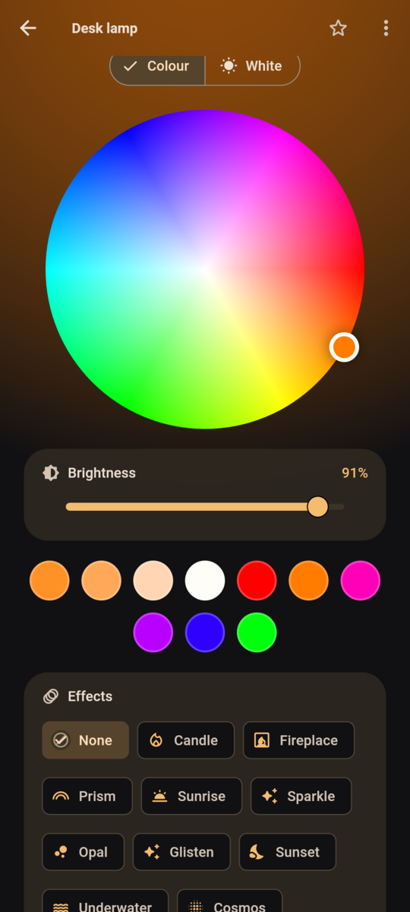
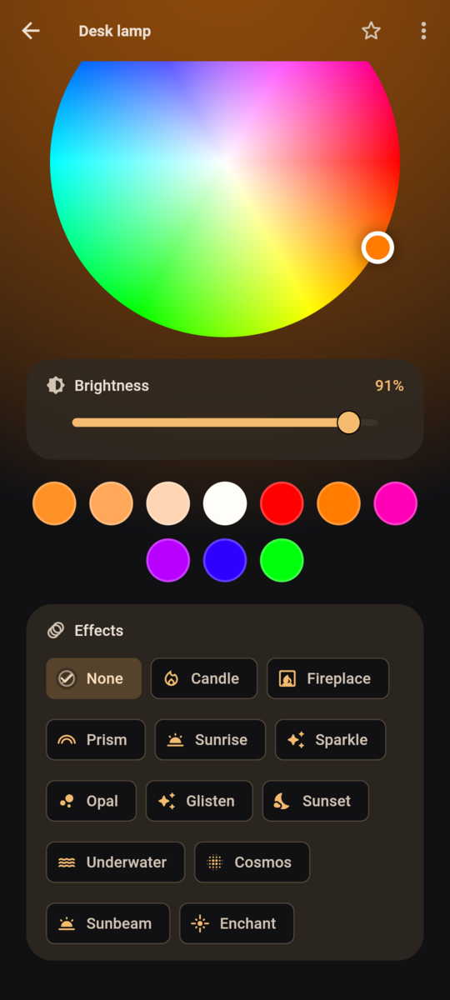
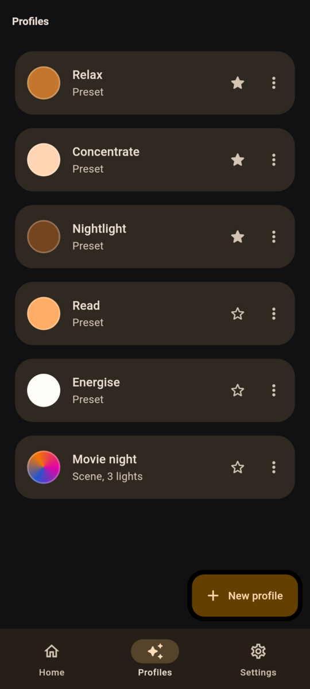

# Lumen


A local-only, open-source Android controller for Philips Hue lights built with Flutter. No cloud account, no analytics, and no external discovery servers.

Repository: [chriscz/lumen](https://github.com/chriscz/lumen)

Lumen controls Philips Hue lights two ways behind a single unified interface:

- **Bluetooth Low Energy (GATT):** Talk straight to Hue Bluetooth bulbs with no bridge required.
- **Hue Bridge (Local REST API v1):** Discover bridges strictly on your local Wi-Fi network, pair with the link button, and control your lights and rooms.

Not affiliated with Signify. Philips Hue is a trademark of Signify.

## Screens

| Home | Colour | Effects | Profiles |
| --- | --- | --- | --- |
|  |  |  |  |

## Features

### Direct Bluetooth and Hue Bridge Control

- **Unified light tiles:** Every light tile glows in its current colour with quick power and brightness controls directly on Home.
- **Adaptive controls per bulb:** Reads each bulb's capabilities (on/off, dimmable white, white ambiance with the bulb's exact colour-temperature range, or full colour) and shows only the controls and effects that bulb supports.
- **Colour wheel and swatches:** Gamut-clamped CIE xy colour wheel, white temperature slider, brightness slider, and quick swatches.
- **Built-in bulb effects:** Start and adjust speed for candle, fireplace, prism, sunrise, sparkle, opal, glisten, sunset, underwater, cosmos, sunbeam, and enchant (on bulbs that support them).
- **Gradient lights:** Edit 2 to 5 colour stops on the colour wheel and pick supported gradient blend modes.
- **Device configuration:** Rename lights directly on the bulb (so other apps see the name), identify (blink), configure power-on behaviour (last state, always on, or always off), and set minimum brightness.
- **Bluetooth pairing helpers:** Lists bulbs already bonded to your phone, uses the proximity handshake with actionable troubleshooting prompts, and lets you make a bulb discoverable for other apps. Bulbs requiring Hue's extra application-layer security are clearly identified instead of failing silently.
- **Local-only bridge discovery:** Finds bridges via known hosts, mDNS (Android `NsdManager` or built-in), SSDP, and LAN scan without contacting cloud endpoints. Automatically reconnects when a bridge drops offline, and remembers bridge lights you removed so they do not reappear on refresh.

### Rooms, Clusters, Profiles, and Sleep Fade

- **Rooms and linked clusters:** Group lights into rooms with a single switch and All off, or link lights into a cluster that moves together while still allowing individual touch-to-detach and rejoin.
- **Profiles and scenes:** Starter presets, captured scenes from your current lights, and custom colour/white presets applied to all lights, rooms, or single lights, with one-tap favourite chips on Home.
- **Sleep fade:** Dim lights to off over up to an hour directly on the bulb or bridge so the fade finishes even if you close Lumen.

### Act as a Hue Bridge

- **Local bridge emulator:** Expose Lumen's lights (Bluetooth bulbs and bridge lights alike) on your Wi-Fi network via the Hue Bridge v1 REST API, mDNS (`_hue._tcp`), and SSDP so other apps (such as another Lumen phone, Home Assistant, or openHAB) can control them.
- **Background service:** Runs as an Android `connectedDevice` foreground service with an ongoing notification showing the listening address and active clients, plus an optional charging-only wake/Wi-Fi lock under Advanced.
- **Stock Android port note:** Ordinary Android apps cannot bind port 80, so Lumen listens on the first free port in `1818, 1919, ..., 2727`. Clients that accept `host:port` work out of the box; clients that hardcode port 80 cannot connect to an unrooted phone.

### Privacy, Diagnostics, and Demo Mode

- **Zero cloud calls:** Discovery and control never leave Bluetooth and your LAN.
- **Diagnostics screen:** Inspect live Bluetooth, bridge, and emulator logs with bridge keys automatically redacted, and share logs when troubleshooting.
- **Demo mode:** Explore the full UI against byte-level simulated bulbs and a simulated bridge (`--dart-define=DEMO=true`).

## Experimental Features

Optional and in-development capabilities live behind Lumen's **Plugin system** (**Settings > Plugins**). Each plugin carries an **Experimental** badge where applicable and can be switched off cleanly at any time: turning a plugin off stops it, restores any lights it modified, and removes its Home buttons, Settings entries, and bridge API routes.

### Music Sync (Experimental Plugin)

Enabled by default and toggleable in **Settings > Plugins**. Open it from the equaliser button on Home (or **Settings > Music sync**).

- **Audio sources:**
  - **Microphone (default):** Works with any speaker or app (including Spotify); requires microphone permission.
  - **Phone sound:** Reads Android's output mix (`Visualizer`) without room noise; works with Spotify on many phones, though some OEM ROMs do not share session 0.
  - **Audio capture:** Uses Android 10+ `AudioPlaybackCapture` with a system confirmation dialog; apps can opt out (Spotify currently blocks capture).
- **Styles:** **Pulse** (flash on beats and shift palette each bar), **Colours** (cycle palette on each beat), and **Glow** (smooth loudness-to-brightness and bass-to-colour). Beat flashes are capped at 3 per second (333 ms minimum interval) for comfort; users sensitive to flashing should use **Glow**.
- **Follow modes and tuning:** Choose **Auto** (beat grid when locked, hits otherwise), **Beat**, or **Hits**, pick All lights, a room, or individual lights, and tune Strength, Sensitivity, Steadiness, and Timing with a live 5-second onset trace.
- **Why it is marked Experimental:** Real-world beat locking through phone microphones or `Visualizer` is still under active refinement (dense tracks can drop lock, some phones mute `Visualizer` session 0, and Hue Entertainment streaming is not yet implemented). See [docs/music-sync.md](docs/music-sync.md) for technical details.

### Versioned Bridge Plugin API (`/__plugins__`)

When **Act as a Hue Bridge** is running, enabled plugins can expose versioned HTTP endpoints under `/__plugins__/<plugin>/v<x.y.z>/` (discoverable via `GET /__plugins__` and authenticated with a paired app's `hue-application-key` header). Music sync exposes `/__plugins__/music-sync/v1.0.0/` as an experimental API that may evolve before stabilizing.

## Installing Lumen

### Option 1: Obtainium (Recommended for Direct Updates)

[Obtainium](https://github.com/ImranR98/Obtainium) tracks GitHub Releases directly and keeps Lumen up to date automatically:

1. In Obtainium, tap **Add App**.
2. Paste the repository URL: `https://github.com/chriscz/lumen`
3. Obtainium automatically detects the release APKs and picks the matching CPU architecture (`arm64-v8a` on most modern Android phones, `armeabi-v7a` on older 32-bit devices, `x86_64` on emulators, or `universal` as fallback).

### Option 2: Direct APK from GitHub Releases

Download an APK from [GitHub Releases](https://github.com/chriscz/lumen/releases):

- `lumen-vX.Y.Z-arm64-v8a.apk`: recommended for most modern Android phones (smallest download)
- `lumen-vX.Y.Z-armeabi-v7a.apk`: older 32-bit ARM Android phones
- `lumen-vX.Y.Z-x86_64.apk`: x86_64 Android devices and emulators
- `lumen-vX.Y.Z-universal.apk`: works on all Android ABIs

### Option 3: F-Droid (Planned)

Lumen is structured for F-Droid inclusion (100% permissive open-source dependencies, Google Play `dependenciesInfo` disabled, Fastlane store metadata in `fastlane/metadata/android/`, and a reproducible-build recipe in `packaging/fdroid/dev.chriscz.lumen.yml`). Once listed on F-Droid with Reproducible Builds enabled, F-Droid will verify and serve the exact developer-signed APK so Obtainium and F-Droid remain interchangeable without signature mismatches.

### Verifying Downloaded APKs

Every GitHub Release ships with `SHA256SUMS.txt` and GitHub SLSA build provenance attestations:

```sh
# 1. Verify file integrity
sha256sum -c SHA256SUMS.txt --ignore-missing

# 2. Verify GitHub Actions build provenance (requires GitHub CLI)
gh attestation verify lumen-vX.Y.Z-arm64-v8a.apk --owner chriscz

# 3. Inspect APK signing certificate fingerprint (Android build-tools)
apksigner verify --print-certs lumen-vX.Y.Z-arm64-v8a.apk
```

Official release APKs are signed with the following certificate:

| Field | Value |
| --- | --- |
| Owner / Issuer | `CN=Lumen, O=chriscz` |
| Key algorithm | 4096-bit RSA (`SHA384withRSA`) |
| Serial number | `2ead252f1804f760` |
| Valid | 2026-11-26 to 2054-04-13 |
| SHA-256 (`apksigner`) | `b2ad24c8b17d25ac0a3c3aa76deb8383b2a04c63896004847cc84e2be9734f29` |
| SHA-256 (`keytool`) | `B2:AD:24:C8:B1:7D:25:AC:0A:3C:3A:A7:6D:EB:83:83:B2:A0:4C:63:89:60:04:84:7C:C8:4E:2B:E9:73:4F:29` |
| SHA-1 (`apksigner`) | `b07a21da60ceb89e8072c26a84b6f65cf7502de1` |
| SHA-1 (`keytool`) | `B0:7A:21:DA:60:CE:B8:9E:80:72:C2:6A:84:B6:F6:5C:F7:50:2D:E1` |

## Building and Testing from Source

Requires Flutter `3.47.7` (Dart `3.13.5`), JDK 21, and the Android SDK (for APK builds).

```sh
flutter pub get --enforce-lockfile
flutter analyze
flutter test                                    # 1,038 unit and headless E2E tests
bash tool/coverage.sh                           # enforces 100% line coverage across lib/
flutter run --dart-define=DEMO=true             # launch with simulated lights
bash tool/package_android.sh --unsigned --debug # build unsigned release APKs locally
```

To run the Ruby hook and release script tests:

```sh
for t in scripts/test_*.rb; do ruby "$t"; done
```

## Documentation

- [Protocol reference](docs/protocol.md): Bluetooth GATT wire format, Hue Bridge local API v1, and Bridge emulation (mDNS/SSDP).
- [Architecture](docs/architecture.md): module layout, design decisions, and testing harness.
- [Music sync](docs/music-sync.md): audio sources, DSP beat tracking, and experimental status.
- [Releasing and signing security](docs/releasing.md): keystore creation and backup, GitHub Environment and ruleset hardening, Obtainium, and F-Droid submission.

## Attribution and License

- **License:** [MIT License](LICENSE), Copyright (c) 2026 Chris Coetzee.
- **Commit attribution:** AI tools are used under human direction to assist development, not as authors or co-authors. Git authorship and `Co-Authored-By` trailers are reserved for humans, and AI tooling is transparently disclosed via `Assisted-by-AI-model` and `Assisted-by-AI-harness` trailers. See [AGENTS.md](AGENTS.md) for details.
