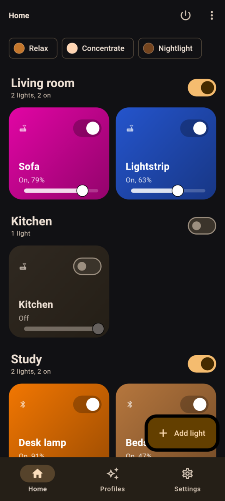

# Lumen: a Hue light controller


An Android app, written in Flutter, that controls Philips Hue lights two ways:

- **Bluetooth**: straight to Hue Bluetooth bulbs over GATT, no bridge needed.
- **Hue Bridge**: through the bridge's local REST API (v1), after a link-button pairing.

Both transports sit behind one model, so every screen works the same for either kind of light.

The protocol notes are in `docs/protocol.md`, the backlog in `docs/architecture.md`, and the architecture in `docs/architecture.md`.

## Screens

| Home | Colour | Effects | Profiles |
| --- | --- | --- | --- |
|  |  |  |  |

Rendered from the simulated home by `SHOTS=1 flutter test test/shots --update-goldens`. The test renderer draws elevation shadows as solid outlines, so the floating buttons look heavier than on a phone.

## Features

- Add Hue Bluetooth bulbs directly, or pair a Hue Bridge (discovery or IP, link button) and bring in its lights and rooms.
- Tiles that glow in each light's colour, with power and brightness on the tile.
- Light detail: colour wheel (clamped to the bulb's gamut), white temperature, brightness, swatches, and the bulb's built-in effects (candle, fireplace, prism, sunrise and more) with speed.
- Controls match each bulb, from what the bulb reports about itself: on/off (no brightness), white, white ambiance (the temperature slider spans the bulb's own range) or colour, with only the effects the bulb supports.
- Gradient lights: a Gradient section with 2 to 5 colour stops, each picked on the wheel, and the blend modes the light supports.
- When power returns (last state, always on at the current brightness and colour, or always off) and minimum brightness, on bulbs that have them.
- Rooms with one switch each; All off.
- Profiles: starter presets, scenes captured from your lights, colour presets built on the wheel, applied to all lights, rooms or single lights, with approximation on bulbs that cannot show a colour. Favourites appear as one-tap chips on Home.
- Sleep fade: dims to off over up to an hour; the bulbs or the bridge run the fade, so the app can close.
- Rename (on the bulb too, so other apps see the name), identify (blink), remove with undo, and per-light reachability. A removed bridge light stays out when the bridge is read again; Settings lists it under its bridge, to add back one at a time or all at once.
- Lights that use Hue's extra (application-layer) security are explained rather than half working: they need the official app or a Hue Bridge.
- Bridge lights refresh every 10 seconds to catch changes made elsewhere.
- Light, dark or system theme. Demo mode with simulated lights.
- Act as a Hue Bridge: other apps on the Wi-Fi control Lumen's lights (Bluetooth bulbs and bridge lights) through the Hue Bridge v1 API.
- Music sync (experimental plugin): the lights pulse, change colour or glow with the music, heard through the microphone, the phone's own sound or audio capture.
- Plugins: optional features switch on and off in Settings, Plugins, and serve their own versioned APIs on Lumen's bridge under `/__plugins__`.

## Music sync

Music sync is an experimental plugin, on by default: Settings, Plugins switches it off (it stops and puts the lights back) or on again.

The equaliser button on Home (or Settings, Music sync) opens Music sync. Pick where to listen, which lights move and how, then Start. Lumen finds the beat and sends each beat to the lights a little before it is due, so they keep time despite the radio delay. Stop puts every light back as it was.

| Listen to | Good for | Needs |
| --- | --- | --- |
| Microphone (default) | Any speaker and any app, Spotify included. | The microphone permission. |
| Phone sound | Music playing on this phone, Spotify included on most phones, without room noise. | The microphone permission (Android asks for it to read the sound output). Some phones do not share it. |
| Audio capture | The cleanest signal from what this phone plays. | Android 10 or later, and a yes in Android's dialog each time. Apps can block it, and Spotify appears to. |

Each source shows what it still needs, and one the phone lacks cannot be picked. A refused permission links to Android's settings.

- **Lights**: all lights, one room, or any lights picked one by one. On/off lights are left alone.
- **Style**: Pulse (flash on the beat, new colour each bar), Colours (next colour every beat) or Glow (brightness follows loudness, no flashing), with a Party, Warm or Cool palette and a Strength slider.
- **Follow**: Auto (the predicted beat while it is steady, each hit as it is heard while it is not), Beat (only the predicted beat) or Hits (each hit, a little late, never waiting for a steady tempo). Glow follows neither.
- **Beat finding**: Sensitivity moves the line a sound must cross to count as an onset; Steadiness sets how sure the beat must be before the lights follow it. The middle of each is the default.
- **Timing**: moves the lights up to 300 ms earlier or later. With a Bluetooth speaker the phone's sound is heard late, so move it towards Later.
- Flashes are kept to three a second at most.
- When the beat goes, the lights keep its tempo for 8 beats or 4 s, whichever is longer, then breathe slowly at it until it comes back. In silence they rest.
- The trace at the top shows the last five seconds: the onset signal as bars with the line a sound must cross, loudness behind it, a tick for each onset, a mark for each beat (a dot when fired, a ring when held, a triangle for a hit, a cross when dropped), breathing as a band, and how close the beat is to a lock. The info button under it explains each mark. **Tracking log**, at the bottom of the screen, writes what the beat finder decides to the log for Diagnostics.
- Music sync keeps listening with Spotify in front, through a foreground service with a "Lumen music sync" notification.
- Through Lumen's bridge: a phone paired with a Lumen bridge moves that phone's lights with music sync like any bridge lights, and paired apps can run the bridge phone's music sync through `/__plugins__/music-sync/v1.0.0/`.

The beat tracking and its limits are in `docs/protocol.mdmusic-sync.md`.

## Plugins

Settings, Plugins lists the optional features, each with a switch and, where it applies, an Experimental label. A plugin switched off leaves nothing behind: its buttons, settings and API go, and it puts back any lights it changed. The choice is kept between runs.

While the phone acts as a Hue Bridge, plugins serve their own APIs beside the Hue API. Start at `GET /__plugins__` and follow the links: each plugin links to its details, which list its versions (semantic, oldest first) and the `latest`, and every answer links to what can be done next. A version's API needs a paired app's key in the `hue-application-key` header:

```sh
curl http://192.168.1.20:1818/__plugins__
curl http://192.168.1.20:1818/__plugins__/music-sync
curl -H 'hue-application-key: <key>' http://192.168.1.20:1818/__plugins__/music-sync/v1.0.0/
curl -X POST -H 'hue-application-key: <key>' http://192.168.1.20:1818/__plugins__/music-sync/v1.0.0/start
```

The requests are in `docs/protocol.mdbridge-emulation.md`, and the ideas that come next (remote music sync, a direct control channel) in the backlog, increment 13.

## Act as a Hue Bridge

Settings, Act as a Hue Bridge, turns the phone into an emulated Hue Bridge. Other apps then see the lights Lumen controls, its rooms (as bridge rooms) and its profiles (as scenes), and can switch, dim and colour them through the v1 API. It does not bridge other Hue devices: the phone has no Zigbee radio.

1. Switch it on. Settings shows the address, for example `http://192.168.1.20:1818`.
2. Announce on Wi-Fi (on by default) advertises the bridge so apps can find it: mDNS as `_hue._tcp.local` (the instance is named after the bridge and the end of its id, for example `Lumen-DDEEFF`) and SSDP. Settings says "Announcing as Lumen-DDEEFF on Wi-Fi via mDNS (Android) and SSDP", or why not, such as a busy multicast port. Switch it off to stay hidden; apps given the address can still use the bridge. The bridge says goodbye on both protocols when it stops. Under Advanced, mDNS and SSDP each have their own switch, and on Android mDNS can come from Android's own responder (NsdManager, the default) or Lumen's built-in one.
3. Press link button in Settings, then pair from the other app within 30 seconds.
4. Settings sums up the paired apps ("2 apps paired, 1 active in the last 5 minutes") and says when each was last seen; remove one to lock it out.

Android does not let ordinary apps use port 80, so the bridge tries 80 first and then listens on the first free port of 1818, 1919, 2020 and so on up to 2727 (ten ports, 101 apart), where Lumen on another phone looks. Settings shows the port in use. Apps that only look on port 80, such as Alexa and the official Hue app, will not find it. Apps that accept `host:port` work: in Home Assistant add the Philips Hue integration by hand with the host `192.168.1.20:1818`; in Lumen on another phone enter the same in Add light, Hue Bridge, Bridge address. Lumen talks plain HTTP to an address with a port and HTTPS to a bare address (a real bridge).

On Android, Run in the background (on by default) keeps the bridge listening with the screen off through a foreground service and a quiet "Lumen bridge running" notification. Battery optimisation opens Android's list so Lumen can be set to Unrestricted, and Stay fully awake while charging (Advanced, off by default) holds a wake lock and a Wi-Fi lock only while plugged in. Settings, Running Lumen as a bridge, explains the trade-offs. Swiping Lumen away from the recent apps still ends the bridge. The research behind it is in `docs/protocol.mdbridge-emulation.md`.

## Run it

```sh
flutter pub get
flutter run                          # on a phone, with real bulbs and bridges
flutter run --dart-define=DEMO=true  # simulated bulbs and a simulated bridge
```

Demo mode runs the same app against the simulated bulbs and bridge the tests use. Its bridge "presses" its own link button every few seconds.

## Cloud environment setup

`tool/setup_cloud_env.sh` prepares a fresh Claude Code cloud container (Ubuntu 24.04, root) to build and test the app. It installs the system packages, Flutter 3.47.7 in `/opt/flutter`, and the Android SDK in `/opt/android-sdk`, writes the environment to `/etc/profile.d/hue-flutter.sh` and `/root/.hue_env`, then runs `flutter pub get`. Each step skips itself when already done, so a re-run takes about a second.

Paste this line into the environment's setup script field so every new session starts ready:

```sh
bash tool/setup_cloud_env.sh
```

Or run `bash ./tool/setup_cloud_env.sh` once from the repository root in a session, then `source /root/.hue_env`. The script does not build the APK; the first Gradle build can hit HTTP 429 from Maven Central, and a later retry usually succeeds.

## Test it

```sh
flutter analyze
flutter test                                          # unit and controller tests
flutter test integration_test -d flutter-tester       # end-to-end, headless, fake time
xvfb-run -a flutter test integration_test -d linux    # end-to-end on a real desktop device
flutter test integration_test -d <android-device-id>  # end-to-end on a phone or emulator
```

The end-to-end tests drive the full widget tree. The simulated bulb decodes the bytes the app writes with its own reading of the GATT protocol, and the simulated bridge answers the v1 REST API, so a passing test proves the wire format and not just the calls.

## Coverage

```sh
tool/coverage.sh            # whole suite; fails below 100% line coverage
tool/coverage.sh test/ble   # some tests; prints uncovered lines per file
```

The gate counts every Dart file in `lib/`, so a file no test loads counts as uncovered. The only excluded line is `void main()`, which only the platform calls; tests start the app through `bootstrap`. Two mDNS tests bind UDP port 5353 on loopback with port sharing, so they fail on a machine where another program holds that port without sharing it.

## Layout

| Path | What |
| --- | --- |
| `lib/domain/` | Lights, rooms, profiles, errors. No Flutter, no I/O. |
| `lib/color/` | xy, RGB, mireds and gamut maths. |
| `lib/transport/ble/` | GATT codec, the driver (connection pool, reconnect) and the universal_ble adapter. |
| `lib/transport/bridge/` | Bridge v1 client and discovery. |
| `lib/emulator/` | The emulated Hue Bridge: v1 API handler, HTTP and SSDP server, settings and the multicast lock. |
| `lib/log/` | The persistent log, the run header and uncaught error capture. |
| `lib/sim/` | Simulated bulbs, bridge and the demo home. |
| `lib/state/` | `HomeController`: the single source of truth, optimistic updates, write coalescing, persistence. |
| `lib/ui/` | Screens and widgets. |
| `packages/lumen_bonded_devices/` | A small local Android plugin: bonded Bluetooth devices and the app settings page. |
| `test/` | Unit and controller tests. |
| `integration_test/` | End-to-end tests and their harness. |

## Pairing a Bluetooth bulb

Open Add light, Bluetooth. Lumen lists two kinds of bulbs:

- **Paired with this phone**: bulbs this phone already has a Bluetooth bond with, for example from the official Hue app. Bonds belong to the phone, so these need no pairing mode; tap one to add it. They often do not advertise, which is why a scan alone misses them.
- **Nearby**: bulbs that advertise. A "Ready to pair" chip marks the ones that accept a new phone right now.

When a bulb will not pair, try these in order. The same steps are in the help card at the bottom of the Bluetooth tab.

1. **Close the official Hue app** (swipe it away from recent apps). A bulb connected to it accepts no other phone.
2. **Make it discoverable**: in the Hue app open Settings, Voice assistants, Amazon Alexa (or Google Home), and tap Make discoverable. Close the Hue app, then add the bulb in Lumen within a minute or two. A bulb Lumen already controls can be made discoverable for another phone or app from its menu, Make discoverable.
3. **Last resort, factory reset**: switch the bulb off and on five times, about a second apart, ending on. It blinks, gets a new Bluetooth address and must be added in the Hue app again too.

If the bulb says its power-on window has passed, switch it off and on and add it within a minute. A bulb joined to a Hue Bridge is best controlled through the bridge. When adding fails, the banner offers Retry and Copy diagnostics (the last 200 log lines).

## Logs and debug mode

Lumen keeps a log in its app storage. It survives restarts and is only removed when you clear it.

1. Open Settings and turn on **Debug logging**. The log then records every Bluetooth step (adverts, connects with timing, services, the pairing handshake, every read and write in hex, the raw platform errors) and every bridge call (with the app key cut to its first four characters).
2. Reproduce the problem, for example try to add the bulb again.
3. Open Settings, **Diagnostics**. It shows Bluetooth state, permissions, lights, connected bulbs and the log size, then the log, newest at the bottom, with level filters. Tap **Share** to send the log file (by mail or chat), or **Save a copy** to keep it, for example in Downloads through Files. **Copy all** copies the log as text. **Clear** (in debug mode) deletes it.

With debug logging off, Lumen logs info, warnings and errors only. Uncaught errors are always logged with their stack traces, and every run starts with a header: app version, build mode, Android version, device, Bluetooth state and permissions.

If Bluetooth permission is missing or Bluetooth is off, Lumen shows one snack bar with Retry rather than asking again on its own; when Android no longer shows the permission prompt, the action opens the app's settings.
